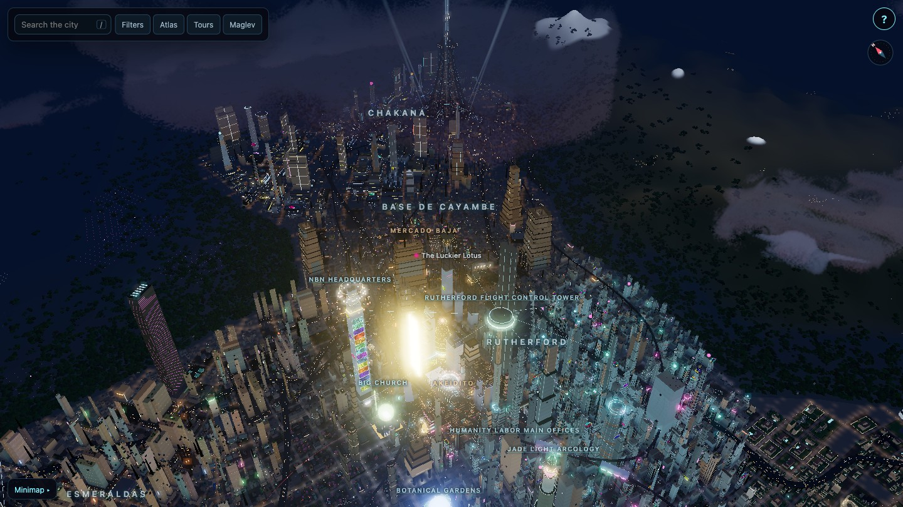
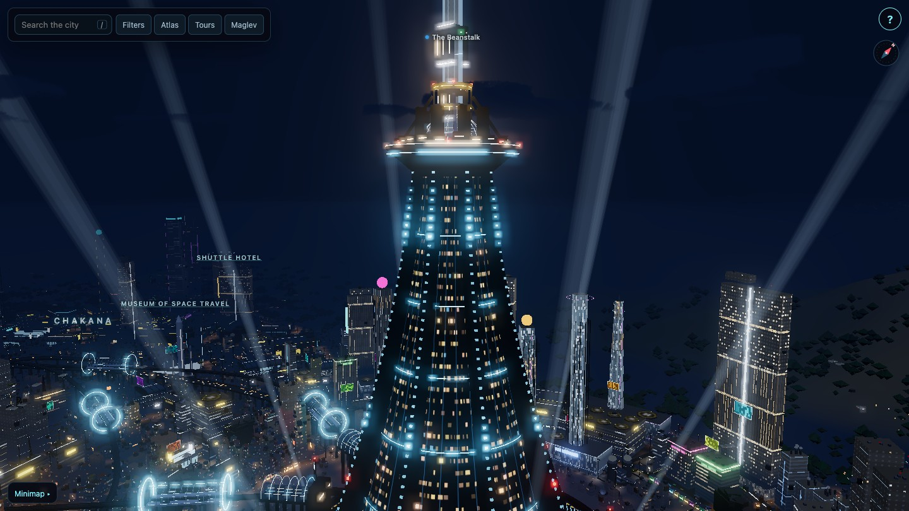
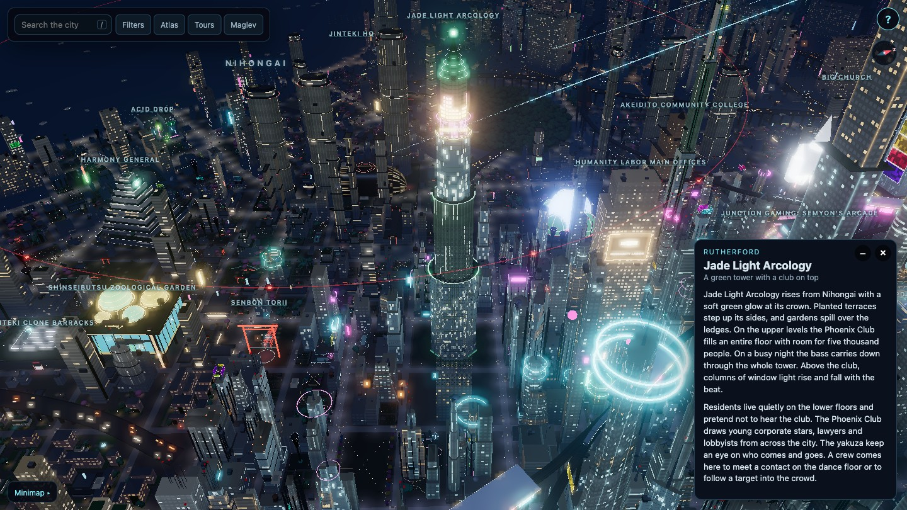
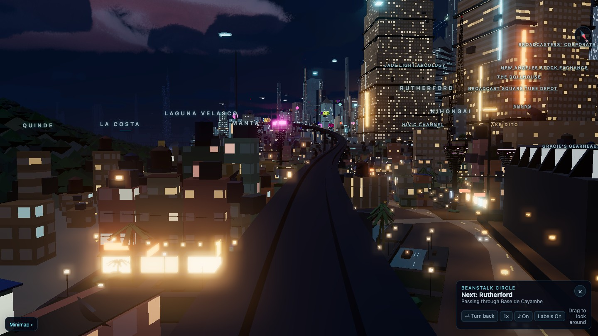
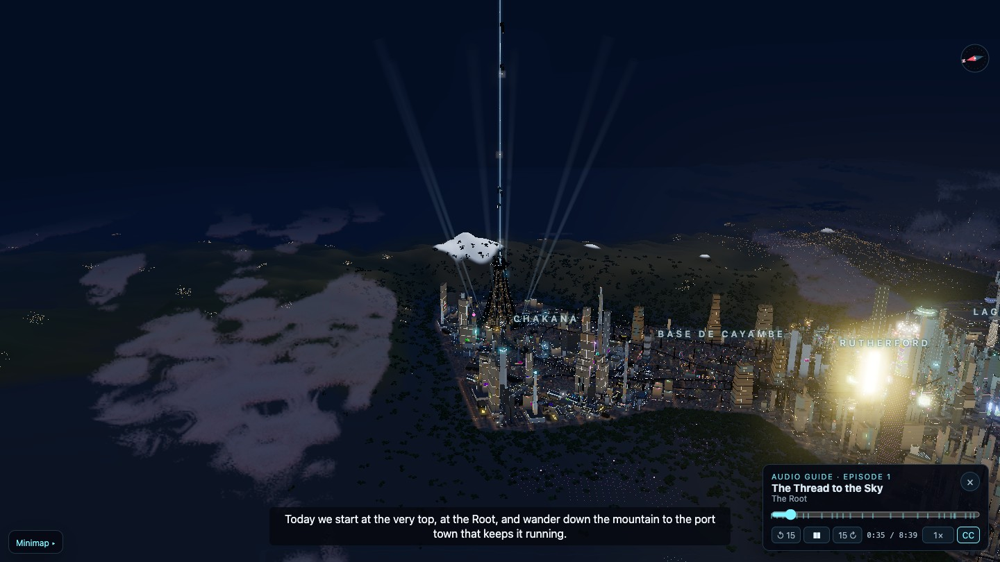

# New Angeles Map

An interactive 3D night map of New Angeles, the city of the Android universe. Fly over eleven districts, open the
cards of over a hundred landmarks, ride the maglev lines and listen to a narrated audio guide. It runs in the
browser with no build step.

The engine behind it knows no setting. It also draws two medieval cities by day and by night, with sun shadows,
a day clock and terrain. Emberford is an invented market town, and Nuremberg is the real city around 1500, at true
scale. See [Medieval settings](#medieval-settings).



## Features

- **A whole city.** Eleven districts, from Chakana at the Root down to Guayaquil and the La Costa farmland. Each
  district has its own building styles, density and street life. The street grid follows the canon district map.
- **Landmarks with cards.** Over a hundred hand-built landmarks, each with a card of setting text. Filters sort
  them into civic, corporate, shops and food.
- **The Beanstalk.** The space elevator rises from the Root, with pods that climb the tether.
- **Maglev rides.** Four tours ride the elevated lines in first person, each with its own music. You can change
  speed, turn back, look around and hide the labels.
- **Narrated audio guide.** Two episodes with Carmen, an NBN-certified city guide. The camera flies along with the
  narration. It has subtitles, playback speed, seeking and resume.
- **A living night.** Ground cars, hover traffic and highway traffic, flickering neon, searchlights, harvesters
  in the fields, low clouds between the towers, fog and bloom.
- **Focus view.** An open card holds the camera on its landmark while you orbit it. Buildings in front of the
  landmark thin out in the shape of its outline.
- **Undercity layer.** A cut-away view shows the tunnels and caverns under the streets.
- **Search, atlas and minimap.** Search finds any landmark or district, the atlas lists them by district, and the
  minimap jumps anywhere.
- **Mouse, trackpad and touch.** Phones and tablets work, and quality adapts to the device.
- **Other settings.** The engine draws any city from a setting pack. Two medieval packs ship with it, with a day
  clock, sun shadows and terrain. See [Medieval settings](#medieval-settings).
- **Smooth edges.** A switch in the corner renders at 1.5 times the screen's pixel ratio and adds SMAA, for
  fast graphics cards.

| | |
|---|---|
|  |  |
| The Root and the foot of the Beanstalk | A landmark card in focus view |
|  |  |
| A maglev ride through Base de Cayambe | The audio guide with subtitles |

## Medieval settings

Two pages show the engine with a medieval kit instead of the cyberpunk one:

| Page | City |
|---|---|
| [`nuremberg.html`](https://washrinserepeat.github.io/new-angeles-map/nuremberg.html) | Nuremberg around 1500, traced at true scale from the real wall, river, streets and landmarks |
| [`emberford.html`](https://washrinserepeat.github.io/new-angeles-map/emberford.html) | Emberford, an invented walled market town on a hill, under a castle |

Both share the same features:

- **Time of day.** A slider in the corner sets the hour, and its play button runs the day. Sun, moon, sky, fog,
  clouds, windows and lanterns follow the clock, from a warm dawn through a clear day and a golden evening to a
  lantern-lit night with stars.
- **Shadows.** The sun or moon casts shadows that turn and lengthen through the day. They are sharp at a wall's foot
  and soften with distance, and walkers and carts cast them too. Creases where walls meet the ground darken.
- **Terrain.** The towns sit on hills. Every plot is a level platform held by a battered retaining wall, with steps
  down to its street, and steep lanes turn into stairs. A moat runs round the wall, with bridges at the gates.
- **A detailed ground.** Cobbled streets and squares with gutters, earth lanes with wheel ruts and puddles, mud
  round the gates and wells, grass verges and yards. Lamp light lies on the ground and follows every slope.
- **Building materials.** Timber frame in several patterns, plaster, coursed ashlar, rubble stone, sandstone quoins,
  tile, slate and thatch, each drawn in the shader.
- **Life.** Townsfolk walk the streets and crowd the market, carts with lanterns drive the roads, barges work the
  river, and guards walk the wall.
- **A walking tour.** The Tours tab holds a stop-by-stop walk past the town's landmarks.

Nuremberg adds:

- The Kaiserburg on its sandstone rock, with the Palas, the round Sinwellturm and the long Kaiserstallung.
- St. Sebald and St. Lorenz with their twin towers, hall choirs and coloured windows, and the Frauenkirche,
  St. Egidien, St. Jakob and St. Klara.
- The Hauptmarkt with its stalls and the Schöner Brunnen, the Gothic town hall, the Heilig-Geist-Spital on its arches
  over the Pegnitz, the Weinstadel with the covered Henkersteg, the Mauthalle, the Nassauer Haus and the Dürer-Haus.
- The double wall with its roofed walk, dozens of towers, the dry moat and the four great round gate towers.
- The Pegnitz between stone quays, with islands and five bridges.
- One fantasy addition, the Lindwurmdom: a soaring Gothic cathedral with openwork spires, flying buttresses and
  glowing stained glass, and a lindworm coiled round its crossing tower that breathes, flexes its wings and smokes.
- The catacombs under the town, on four levels the Town, Cellars, Dungeons, Deep and Abyss buttons peel open, every
  wall lit by flickering torches:
  - Cellars: the Kloake sewers along the Pegnitz, the Kaiserburg casemates with Eppelein's cell, the Lochgefängnisse
    and their torture chamber, the bone halls of St. Sebald and the rock-cut Felsengänge beer cellars.
  - Dungeons: a ring of passages with cells, crypts and guard rooms, the grotto of the Pegnitz Nix with his soul pots
    and a rat king, Rumpelstilzchen's straw chamber and hearth, and a smugglers' tunnel to the moat.
  - Deep: Alberich's hoard with dwarf forges and the Tarnkappe, the Totenweg, and the Walpurgissaal, where witches
    sway round a turning sigil and the Black Goat rises out of it.
  - Abyss: Frau Holle's meadow at the bottom of the castle well, with falling snow, and the lindworm's old lair under
    the Lindwurmdom, with its shed skin and a clutch of glowing eggs.
- About 3,700 houses of eight kinds, from five-storey patrician houses with dormer rows and oriels to timber-framed
  craftsmen's houses, brewers' houses with hoists and small back-lane houses, each in its own stone, plaster and
  roof colours.

`?look=day` and `?look=night` hold a fixed light instead of the clock. `?time=HH:MM` opens at an hour, and
`?cycle=<minutes>` runs a whole day in that many minutes.

## Run it

Serve the folder over HTTP and open it in a browser:

```bash
python3 -m http.server 8000
```

Then open http://localhost:8000/, or `nuremberg.html` and `emberford.html` for the medieval cities. The live version runs at
https://washrinserepeat.github.io/new-angeles-map/. Three.js r160 loads from the jsDelivr CDN. Every other file is in this
repository. Any static host works, GitHub Pages included.

## Controls

| Input | Action |
|---|---|
| Mouse | Drag to move, right-drag to turn, scroll to zoom |
| Trackpad | Two fingers to move, pinch to zoom, <kbd>⌥</kbd> and two fingers to turn and tilt |
| Touch | Drag to move, pinch to zoom, twist to turn, slide two fingers up or down to tilt |
| <kbd>/</kbd> | Jump to search |
| <kbd>?</kbd> or four taps on the ? button | Show the tuning panel |
| Time slider (medieval pages) | Set the hour; the play button runs the day |

## URL options

| Option | Effect |
|---|---|
| `?listen=e01-the-thread-to-the-sky` | Opens an audio guide episode, paused |
| `?layer=undercity` | Starts in the undercity layer (New Angeles) |
| `?layer=cellars` | Starts on a catacomb level (Nuremberg): `cellars`, `dungeons`, `deep` or `abyss` |
| `?showcase=<family>` | Shows one kit family on an empty grid, at three style weights |
| `?probe=live` | Shows frame time, CPU time, draw calls and uploads, with buttons to switch parts off |
| `?probe` | Measures each part of the scene in turn |
| `?time=17:30` | Medieval pages: opens at that hour |
| `?cycle=4` | Medieval pages: runs a whole day in that many minutes |
| `?look=day` or `?look=night` | Medieval pages: holds a fixed light instead of the clock |

## How it is built

| Path | Content |
|---|---|
| `index.html` | Page and the import map |
| `ui.css` | The interface styles, with New Angeles' colours as CSS variables |
| `engine/` | Renderer, city generator, controls, cards, rides, audio guide. It knows no setting |
| `settings/new-angeles/` | The New Angeles setting pack: `setting.js` (look, scale, styles, transport, tours, audio guide) and the files below |
| `settings/new-angeles/kits/` | Building and landmark builders, one file per family |
| `settings/new-angeles/landmarks/` | The Beanstalk and the terrain |
| `settings/new-angeles/places/` | Two named places that the audio guide films |
| `settings/new-angeles/content/` | Card texts for landmarks and districts |
| `city.json` | Streets, lots, districts and transit lines, made by `gen/` |
| `audio/` | Audio guide episodes with their cue files, and the ride music |
| `MODULES.md` | Reference for kit and landmark modules and the helper API |
| `SETTINGS.md` | How a setting pack is built, for a city other than New Angeles |

The engine reads `city.json` and fills every lot with a kit picked by district, density and a seeded random, so
the city looks the same on every load. Landmarks claim a block near their position and build their own meshes.
Static meshes merge into chunks at load, so the city draws in a few hundred calls.

## Other settings

The engine in `engine/` draws any city from a setting pack in `settings/<id>/`. A pack holds the look, scale,
building styles, kits, transport, audio guide and card texts. Each page names its pack in
`<meta name="setting">`. The repository has three packs:

| Page | Pack | Content |
|---|---|---|
| `index.html` | `settings/new-angeles/` | New Angeles, the full city |
| `emberford.html` | `settings/emberford/` | Emberford, a walled medieval market town with a keep, church, market hall and a walking tour |
| `nuremberg.html` | `settings/nuremberg/` | Nuremberg around 1500 at true scale: the double wall, the Pegnitz, the Kaiserburg, St. Sebald, St. Lorenz, the Hauptmarkt and some 3,700 houses, with a walking tour |
| `sandbox.html` | `settings/sandbox/` | A minimal test town that shows what the engine needs at least |

To make your own setting, copy `settings/sandbox/` and its page, then change the values. `gen/town.py` writes
a walled or open town from a short JSON file, as for Emberford. It also takes a traced plan (a wall outline,
streets, sites, a river through the town and ward boundaries) and fills the blocks with lanes, as for Nuremberg.
`SETTINGS.md` documents every field of a pack.

## Extending

`MODULES.md` documents the module API in full. These are the common cases.

### Add a landmark

Add an entry to the `landmarks(H)` export of a file in `settings/new-angeles/kits/`:

```js
export function landmarks(H) {
  return {
    my_tower: {
      at: [640, 520],                 // position in canon map pixels
      label: 'My Tower',              // name on the map; also the card key
      minSide: 46, reach: 400,        // smallest block it fits, and how far it may move to find one
      build(x, z, w, d, st, r) {      // local block frame; r() is the seeded random
        H.bld(0, 0, 30, 30, 180, st, r);
      },
      update(t, dt) {},               // optional, runs every frame
    },
  };
}
```

A map pixel `(u, v)` lies at world `((u - 680) * 3.6, (v - 390) * 3.6)` metres, as `settings/new-angeles/map.js` sets.
Add the card to the family's file in `settings/new-angeles/content/`, keyed by the label:

```json
"My Tower": { "kicker": "One line under the title", "category": "civic", "text": ["First paragraph.", "Second paragraph."] }
```

`category` is one of `civic`, `corp`, `shop` or `food`. A new family file also needs its name in `kits.finds`
in `settings/new-angeles/setting.js`. Use `?showcase=<family>` to look at its kits on an empty grid.

### Add building kits

A district file exports `kits(H)` for lots, `tiers` to place those kits by density, and `blocks(H)` for whole
blocks. Kit names share one namespace, so prefix them with the district.

### Add an audio guide episode

An episode is an MP3 plus a cue file in `audio/tour/`, named `<id>-en.mp3` and `<id>-en.cues.json`. Add it to
`EPISODES` in `engine/audiotour.js`. The cue file holds the subtitles and the camera moves, both timed in seconds:

```json
{
  "lines": [{ "t": 12.4, "d": 3.1, "who": "GUIDE", "text": "Welcome to New Angeles." }],
  "cams": [{ "t": 0, "cue": "sky \"The Root\" x=650 y=250 z=-990 az=200 turn=-25 el=.3 r=4200 t=17.5" }]
}
```

Camera verbs include `view`, `orbit`, `pan`, `dolly`, `spiral`, `gaze`, `sky`, `district` and `wide`. Most take
a quoted landmark name. `engine/audiotour.js` documents each one.

### Add ride music

Each maglev tour in `engine/ride.js` names a `music` key, which plays `audio/ride/<key>.mp3` as a loop.

## Contributing

Contributions are welcome: new landmarks, building kits, card texts, audio guide episodes, fixes and performance
work. Open an issue to discuss a larger idea first, or send a pull request.

- Keep it original. Write your own descriptions and build your own models. Do not copy official artwork or book
  text.
- Keep randomness seeded through `r()` or `H.rng(H.hash(a, b))`, never `Math.random`, so the city stays the same.
- Keep the city fast. Check your change with `?probe=live` and keep the draw calls and frame time where they were.
- Keep light dim. Emissive values stay mostly under 1, so only signs and accents bloom.
- Check the browser console for errors before you send the change.

This repository is published from a larger private project. Merged changes are carried back into it, so later
updates keep them.

## Fan work

New Angeles Map is an unofficial fan project. It is not affiliated with or endorsed by Fantasy Flight Games,
Asmodee or Null Signal Games. Android, Netrunner, New Angeles and all related names, places and characters
belong to their owners.

The map, its models and its code are original work. Some landmark names and descriptions draw on the Android
setting books and on Genesys Foundry fan supplements. No official artwork or book text is included. The
audio guide narration and the ride music are AI-generated.

## License

MIT, see `LICENSE`. The license covers the original work in this repository: the code, the models, the card
texts and the audio. It grants no rights to the Android names and setting, which belong to their owners.

The street generator core in `gen/mapgen/` is vendored from MapGenerator and keeps its own LGPL-3.0 license.
`gen/mapgen/UPSTREAM.txt` names the upstream commit.

Built with [Three.js](https://threejs.org/).
